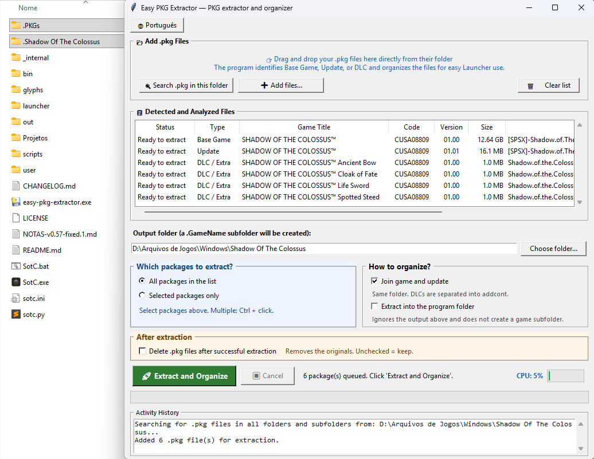
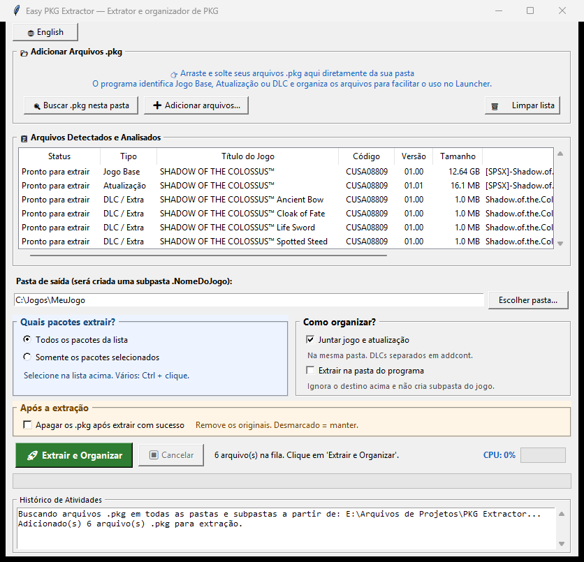
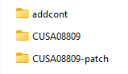

# Easy PKG Extractor

Extrai e organiza arquivos `.pkg` de PS4 compatíveis, pensando no uso com launchers de portes de jogos para PC. **Não baixa jogos, não inclui um launcher e não executa o jogo.**

Você pode extrair todos os pacotes ou escolher somente alguns. O programa identifica jogo base, atualização e DLC e reaproveita arquivos já extraídos corretamente.

## 1. Baixar e preparar

Você precisa de Windows de 64 bits, PKGs completos e compatíveis, permissão para gravar e espaço livre para o conteúdo extraído. Ele pode ocupar mais espaço que o PKG; a substituição de arquivos também usa espaço temporário.

1. Em [Releases](https://github.com/gustasrod/easy-pkg-extractor/releases/latest), baixe **`easy-pkg-extractor.exe`**.
2. O download já é o programa pronto: **não precisa extrair ZIP nem instalar Python**.
3. Coloque o executável na pasta do launcher e os PKGs numa subpasta, por exemplo `.PKGs`:

```text
Pasta do launcher\
├─ arquivos do launcher...
├─ easy-pkg-extractor.exe
└─ .PKGs\
   ├─ jogo-base.pkg
   ├─ atualizacao.pkg
   └─ dlc.pkg
```

Os nomes acima são exemplos. `.PKGs` é uma sugestão, não um nome obrigatório. Não são distribuídos jogos, PKGs, saves ou launchers de terceiros.



*Exemplo recomendado: o EXE fica junto do launcher; `.PKGs` guarda os pacotes e a pasta com ponto no início guarda o jogo extraído. Os outros arquivos mostrados pertencem ao launcher, não a este download. O destino exibido na janela é o local usado nesse exemplo; confira o seu antes de extrair.*

## 2. Abrir e extrair

1. Abra `easy-pkg-extractor.exe`. Ele busca automaticamente os `.pkg` na pasta onde está salvo e nas subpastas.
2. A janela começa em inglês. Para mudar para português, clique em **Português**, no canto superior esquerdo.
3. Confira a lista. **Buscar .pkg nesta pasta** repete a busca; **Adicionar arquivos...** permite escolher outros PKGs. Também é possível arrastar arquivos ou pastas para a janela.
4. Em **Pasta de saída**, escolha onde guardar o jogo. Para deixar a extração junto do launcher, escolha a própria pasta do launcher.
5. Mantenha **Todos os pacotes da lista** ou marque **Somente os pacotes selecionados**. Nesse segundo modo, destaque os PKGs na lista; use **Ctrl + clique** para escolher vários.
6. Clique em **Extrair e Organizar** ou **Extrair pacotes selecionados**, conforme o modo escolhido. Aguarde o status de conclusão e confira o histórico.



*A imagem mostra seis pacotes analisados, antes da extração. O tamanho na lista é o do PKG, não o espaço final do jogo. O histórico dessa captura também avisa que `easy-pkg-extractor.pkg` não é um PKG de PS4 válido: esse arquivo não entrou na lista. Não renomeie o `.exe` ou o `.py` para `.pkg`.*

### Opções que você precisa conhecer

| Opção | O que faz |
| --- | --- |
| **Juntar jogo e atualização** | Vem marcada. Coloca os arquivos da atualização na pasta do jogo; arquivos de mesmo caminho podem ser substituídos. DLCs ficam separados. |
| **Extrair na pasta do programa** | Vem desmarcada. Usa a pasta do EXE em vez do destino escolhido; veja a exceção abaixo. Não aceita jogos base/atualizações de códigos diferentes no mesmo lote. |
| **Apagar os .pkg após extrair com sucesso** | Vem desmarcada, preservando os originais. Se marcada, tenta apagar cada PKG assim que ele termina. |

**Cuidado com a exclusão:** cancelar ou ter erro em um pacote posterior não recupera os PKGs anteriores já apagados. Para manter os originais, deixe essa opção desmarcada.

**Exceção do modo “na pasta do programa”:** jogo base e atualização juntada ficam diretamente ao lado do EXE, e DLCs ficam em `addcont`. Se você separar a atualização e houver um jogo base com nome válido na lista, ela ainda irá para `.NomeDoJogo\CUSAxxxxx-patch`.

## 3. Onde ficam os arquivos

No modo normal, com o jogo base na lista, o programa cria uma pasta com ponto no início, como `.SHADOW OF THE COLOSSUS`, dentro da saída escolhida:

```text
Pasta de saída\
└─ .NomeDoJogo\
   ├─ CUSAxxxxx\             jogo base e atualização juntada
   ├─ CUSAxxxxx-patch\       atualização, quando extraída separadamente
   └─ addcont\
      └─ CUSAxxxxx\
         └─ ID_DO_DLC\       arquivos do complemento
```

O nome vem do título lido no PKG base. Se esse campo não existir, usa o nome do arquivo sem `.pkg`. Caracteres incompatíveis são ajustados; se não restar um nome válido, usa o código do jogo. Títulos iguais de jogos de códigos diferentes recebem uma identificação para não se misturarem.

Para cada código de jogo, a extração segue esta ordem: **base → atualizações da mais antiga para a mais nova → DLCs**. A lista pode continuar contendo o jogo base mesmo quando você escolhe extrair apenas uma atualização ou um DLC: ele ainda serve para definir o nome da pasta.



*Exemplo de pastas com uma atualização separada. Para usar essa organização, desmarque **Juntar jogo e atualização**.*

Sem um jogo base com nome válido na lista, o programa avisa e usa o código do jogo. Uma atualização vai para `CUSAxxxxx-patch`; com juntar marcado e uma pasta `CUSAxxxxx` já existente, pode usar essa pasta. DLCs continuam em `addcont`.

O programa não limpa arquivos extras já existentes. Para evitar misturar versões ou jogos, use o destino correto e não mova nem altere o PKG durante a operação.

## 4. Continuar depois de erro ou cancelamento

Um erro de extração interrompe o lote. Os arquivos já concluídos ficam no destino; cancelar não desfaz o que terminou.

Para tentar de novo ou extrair outro pacote:

1. Mantenha a pasta de saída, as opções de organização e o jogo base na lista, se ele já estava nela. Confira no histórico se o destino continua o mesmo.
2. Marque **Somente os pacotes selecionados** e destaque apenas os PKGs desejados.
3. Clique em **Extrair pacotes selecionados**.

Arquivos completos e iguais ao conteúdo do PKG são mantidos. Ausentes, incompletos ou diferentes são refeitos por inteiro. A conferência também pode levar tempo; o programa não pula automaticamente todos os pacotes com status concluído.

O registro fica em `.pkg-extractor` dentro do destino de cada pacote, por exemplo `.NomeDoJogo\CUSAxxxxx\.pkg-extractor`. Se esse registro estiver ausente ou ilegível, os arquivos ainda podem ser comparados diretamente com o PKG.

Cada arquivo é gravado em um temporário antes de substituir sua versão final. Em caso de cancelamento normal ou falha durante essa gravação, a versão anterior daquele arquivo é preservada. Isso não substitui um backup.

## Problemas comuns e limitações

| Situação | O que conferir |
| --- | --- |
| A lista está vazia | Confira a pasta do executável, a extensão `.pkg` e os avisos do histórico. Use **Adicionar arquivos...** para procurar em outro local. |
| **Criptografia oficial** | O programa não encontrou a tabela interna esperada e ignora o pacote. Esse aviso sozinho não comprova sua autenticidade. Confirme o formato e a origem do arquivo. |
| **Área compactada (PFSC) não encontrada** | Faltou uma estrutura necessária àquele pacote. Ele pode estar incompleto, danificado ou num formato não suportado. Confira se terminou de baixar ou copiar. DLCs válidos com somente licença e informações do pacote são tratados sem exigir essa área. |
| Pacote alterado desde a análise | Espere a cópia ou o download terminar; limpe a lista e adicione os arquivos novamente. |
| Destino de outro jogo ou sem identificação segura | Escolha uma pasta separada. Não apague arquivos desconhecidos para forçar a extração. |
| Erro ao gravar ou falta de espaço | Confira espaço livre e permissão na pasta de saída. Depois use os passos de retomada acima. |

**Nem todo `.pkg` é compatível.** As mensagens usam o rótulo **fake PKG 5.05+**; `5.05+` não é um requisito do Windows e esse rótulo não garante que qualquer pacote será aceito. O programa precisa da estrutura e das chaves previstas, não converte pacotes oficiais nem fornece chaves que estejam faltando.

O conteúdo extraído precisa ser aceito pelo launcher que você usa. Concluir a extração não garante que um jogo vá funcionar no PC.

O EXE usa uma pasta `_MEI...` no temporário do Windows enquanto está aberto. Ela normalmente é removida ao fechar; pode sobrar após encerramento forçado. Não é a pasta do jogo extraído. Para cancelar, prefira o botão do programa e aguarde o fechamento normal.

## Uso avançado

<details>
<summary>Extrair um pacote pelo terminal</summary>

No PowerShell aberto na pasta do executável:

```powershell
.\easy-pkg-extractor.exe --no-gui "C:\Jogos\MeuJogo\.PKGs\jogo-base.pkg" "C:\Jogos\MeuJogo\CUSAxxxxx"
```

Os caminhos são exemplos. Esse modo extrai **um pacote diretamente para o destino informado**, sem a organização automática da janela. Não apresenta as opções de seleção ou de exclusão dos PKGs.

</details>

<details>
<summary>Executar pelo código Python</summary>

Estas etapas são para quem usa o código-fonte, não para quem baixou o EXE pronto. O ambiente conferido usa **Python 3.12.10 no Windows de 64 bits**, com Tkinter (componente de janelas); outras combinações não foram validadas nesta revisão.

Baixe `easy-pkg-extractor.py` deste repositório e abra o terminal na pasta onde ele está salvo. Com Python disponível, instale o componente necessário para extrair e a aceleração opcional:

```powershell
python -m pip install pycryptodome==4.0.1 zlib-ng==1.0.0
```

Para abrir:

```powershell
python easy-pkg-extractor.py
```

`pycryptodome` é necessário para extrair. `zlib-ng` é opcional ao executar o Python, mas acelera a descompactação. O indicador de CPU funciona com `psutil`, se disponível, ou com a alternativa do Windows. Nesse modo, a busca automática parte da pasta do arquivo `.py` e também inclui as subpastas.

Os arquivos públicos são este README, `easy-pkg-extractor.py` e as imagens em `docs/images`. O programa pronto fica somente nos lançamentos, como `easy-pkg-extractor.exe`.

</details>

Use somente arquivos que você tem direito de utilizar. O projeto não é afiliado à Sony, PlayStation ou aos desenvolvedores dos jogos.
